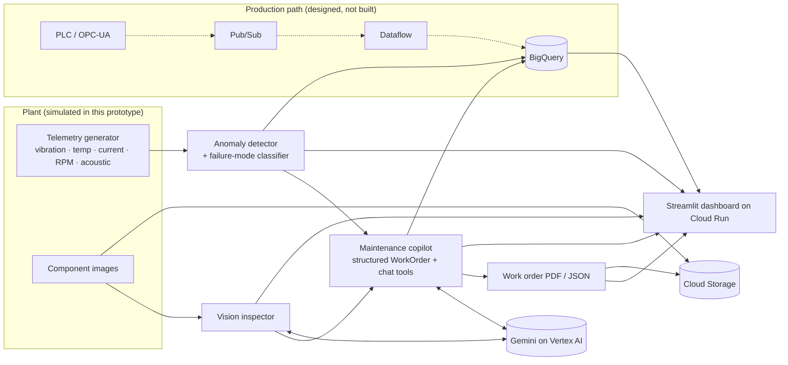

# 🏭 FactoryPulse

**Industrial Predictive Maintenance & Visual Inspection Copilot** — AI Builder Cup 2026, *Manufacturing: Intelligent Operations & Industrial Efficiency*.

FactoryPulse turns three weak, separate signals — drifting machine telemetry, a photo of a suspect component, and a binder of SOPs — into one actionable, schema-validated **maintenance work order**. Gemini on Vertex AI reads the image (finding and boxing hairline cracks, pitting, heat tint), reasons over the anomaly report and the relevant SOPs, and returns a criticality rating, remaining-useful-life estimate, part numbers and a lock-out/tag-out repair procedure. Every AI result is labelled with where it came from (live Gemini, fallback, or offline mock), and deterministic safety floors stop the model from under-rating a critical fault.

> **Live demo URL:** https://factorypulse-gnbcujjj5q-uc.a.run.app · **Demo video:** `<fill in>`
> All plant data, SOPs and part numbers are **synthetic / illustrative**; see [Honest limitations](#honest-limitations).

## Problem → solution

| Track pain point | What FactoryPulse does |
|---|---|
| Unplanned downtime from rotating-equipment faults | Streaming-style anomaly detection (limits + z-score + volatility) with failure-mode attribution and hours-to-limit projection |
| Quality escapes / missed cracks | Gemini multimodal inspection with localized defect boxes and severity grading |
| Tribal knowledge, slow triage | Copilot correlates telemetry + vision + SOPs into a work order and answers questions with tool-calling lookups of SOPs and spare parts |
| Safety | LOTO steps first in every procedure; safety floors raise under-rated criticality and force LOTO for HIGH/CRITICAL; overrides are shown |
| Trust in AI output | Provenance badge on every result, exact error text on fallbacks, Pydantic-validated outputs, retries with validation feedback |

## Features
- **System Overview** – fleet health, active alerts, one-click **Demo Scenario**, *Fleet analytics* (BigQuery or in-memory), and an assumption-driven **impact estimate**.
- **Telemetry Anomaly Explorer** – inject faults (inner-race bearing, thermal overload, cavitation) with adjustable severity, live-replay stream, Plotly charts with limit lines and anomaly markers, and a **Real Data Validation** panel (CWRU).
- **Visual QA Lab** – synthetic samples, a real-image **sample gallery** (`sample_images/`), or your own uploads; annotated boxes (approximate - see [accuracy](#vision-localization-accuracy-measured)), severity table, provenance.
- **Field Engineer Copilot** – structured `WorkOrder` generation, root-cause chat with tool-calling, **PDF / JSON export**, optional save to Cloud Storage.
- **Resilience** – timeouts, 2 retries with exponential backoff on 429/5xx, validation-retry, visible fallback.

## Architecture


Details and data flow: [docs/architecture.md](docs/architecture.md).

## Google Cloud services

| Service | Role | Status in this repo |
|---|---|---|
| **Vertex AI (Gemini)** | Vision inspection, structured triage, tool-calling chat (`google-genai` SDK, `gemini-2.5-flash`) | Implemented; verify with `scripts/preflight.py` |
| **Cloud Run** | Hosts the Streamlit app (2 vCPU / 2 GiB, min 1 instance, session affinity) | Implemented; `deploy.sh` |
| **Cloud Storage** | Inspection images, exported work-order PDF/JSON (`FACTORYPULSE_GCS_BUCKET`) | Implemented, optional |
| **BigQuery** | Telemetry snapshots, anomaly flags, work orders + 3 analytics queries (`FACTORYPULSE_BQ_DATASET`) | Implemented, optional |
| **Cloud Build / Artifact Registry** | Build from source during `gcloud run deploy --source .` | Used by `deploy.sh` |
| **Pub/Sub → Dataflow → BigQuery** | Real streaming ingestion from PLC/OPC-UA | **Designed only** (production path) |

## Quick start (local, no credentials needed)

```bash
python -m venv .venv && source .venv/bin/activate
pip install -r requirements.txt
streamlit run app.py          # http://localhost:8501  (sidebar badge shows OFFLINE MOCK)
```

With no credentials the app runs on a deterministic rule engine and says so everywhere (`mock` provenance). Cloud Run never does this: when `K_SERVICE` is set the app resolves to Vertex AI.

### Authenticate to Vertex AI

```bash
gcloud auth login
gcloud auth application-default login
gcloud services enable aiplatform.googleapis.com
export GOOGLE_GENAI_USE_VERTEXAI=true GOOGLE_CLOUD_PROJECT=YOUR_PROJECT GOOGLE_CLOUD_LOCATION=us-central1
python scripts/preflight.py        # one REAL call each: vision, structured triage, tool-calling chat
streamlit run app.py               # badge: VERTEX AI
```
`preflight.py` prints a PASS/FAIL table (provenance, latency, exact error text) and exits non-zero on failure. Alternatively use a Gemini API key: `export GEMINI_API_KEY=...`.

## Deploy to Cloud Run

```bash
./deploy.sh YOUR_PROJECT_ID us-central1      # or PROJECT_ID=... REGION=... ./deploy.sh
./scripts/smoke_test.sh <service-url>
```
`deploy.sh` is idempotent: enables APIs, creates the `factorypulse-sa` service account (`aiplatform.user`, `bigquery.dataEditor`, `bigquery.jobUser`, bucket-scoped `storage.objectAdmin`), creates the bucket and BigQuery dataset, deploys from source (`--allow-unauthenticated --memory 2Gi --cpu 2 --timeout 3600 --min-instances 1`), creates a `factorypulse-preflight` Cloud Run job, and prints the URL. It never sets `FACTORYPULSE_FORCE_MOCK`. Step-by-step with expected output: [DEPLOY_CHECKLIST.md](DEPLOY_CHECKLIST.md).

## Environment variables

| Variable | Default | Purpose |
|---|---|---|
| `GOOGLE_GENAI_USE_VERTEXAI` | – | `true` → use Vertex AI (ADC / service account) |
| `GOOGLE_CLOUD_PROJECT` | from ADC | GCP project for Vertex AI, BigQuery, Storage |
| `GOOGLE_CLOUD_LOCATION` | `us-central1` | Vertex AI region |
| `GEMINI_API_KEY` | – | Gemini Developer API instead of Vertex |
| `GEMINI_MODEL` | `gemini-2.5-flash` | Model id |
| `FACTORYPULSE_LLM_TIMEOUT_S` | `60` | Per-call timeout |
| `FACTORYPULSE_GCS_BUCKET` | – | Save images and work orders to this bucket |
| `FACTORYPULSE_BQ_DATASET` | – | Log to / query BigQuery (`dataset` or `project.dataset`) |
| `FACTORYPULSE_BQ_LOCATION` | `US` | BigQuery dataset location |
| `FACTORYPULSE_FORCE_MOCK` | – | `1` forces offline mode (tests/dev only) |
| `K_SERVICE` | set by Cloud Run | Forces Vertex resolution; never defaults to mock |

See [.env.example](.env.example).

## Real-data validation (CWRU bearing dataset)

`python scripts/validate_real_bearing_data.py` downloads 16 public recordings from the [Case Western Reserve University Bearing Data Center](https://engineering.case.edu/bearingdatacenter/download-data-file) (normal baseline + inner-race faults, 3 diameters × 4 motor loads) and runs the detector (default settings) on 50 ms window-RMS features. Results committed in `reports/validation_cwru.json`:

| Metric (window level, 12 fault streams) | Before deadband fix | **Current** |
|---|---|---|
| Fault detected | 12 / 12 streams | **12 / 12** streams, first window |
| Recall | 100 % (0 FN) | **99.96 %** (2433 TP, 1 FN) |
| Precision | 74.1 % (849 FP) | **99.0 %** (24 FP) |
| F1 | 85.1 % | **99.5 %** |
| False alarms on held-out *normal*, same motor load as baseline | 0 / 1215 | **0 / 1215** |
| False alarms on held-out *normal*, different motor load | 849 / 6345 (13.4 %) | **24 / 6345 (0.4 %)** |

**How this changed, and how to read it.** The first run exposed a load-sensitive baseline (13.4 % false alarms when the motor load differed). Separately, the live demo showed a *healthy simulated* asset in WARNING: 43 % of healthy simulated windows raised a finding (0 of 300 after the fix) because normal duty-cycle swings exceeded 3.5σ of a short baseline. Both were addressed with an **engineering deadband** (`MIN_DEVIATION` in `telemetry.py`): a z-score excursion only counts if the absolute change is also physically meaningful. The deadband values were chosen from simulator behaviour and **were not iterated on CWRU** - but CWRU was measured after the change, so treat the improvement as encouraging, not as an independent confirmation. On the rescaled CWRU feature the vibration deadband acts as a ~30 % change from baseline RMS, which these large seeded faults (0.007-0.021″) clear easily; subtler real faults may be missed. A fixed baseline can still be load-sensitive in principle (24 residual cross-load false alarms, all with the load-3 baseline). Windows are autocorrelated, so counts are not independent samples. The Telemetry-tab panel shows the same numbers, the earlier-version comparison, method and limitations.

## Vision localization accuracy (measured)

Measured live on `gemini-2.5-flash` (Vertex AI) against the known defect boxes of the three *synthetic* samples (weld, gear, bearing; 6 ground-truth defects), vision call with thinking off:

| Result | Value |
|---|---|
| Defects found with the correct type | 13 / 18 (3 images × 3 repeats) |
| Mean box IoU, found defects | **0.45** (0.25 with the model's default thinking) |
| Mean box IoU, counting misses as 0 | **0.32** |
| Large features (weld crack, heat tints) | IoU ≈ 0.5–0.6 |
| Small / subtle features (gear wear patch, pitting clusters) | IoU ≈ 0.0–0.4; one wear patch was boxed in empty background |
| Latency (thinking off vs default) | ≈ 5.7 s vs ≈ 11.2 s |

So **boxes are approximate**: strong on large features, weak on small or subtle ones, and defect *types* are sometimes wrong (a bearing spall was labelled `other`). The `confidence` field is the **model's own self-reported number, not a calibrated probability**. Small sample, synthetic images, one model: treat as indicative, not as a benchmark. The pixel conversion itself is unit-tested; the error is in the model's localization.

## Honest limitations
- **Telemetry, SOPs, part numbers, plant assets and cost figures are synthetic.** The impact panel is driven by editable *assumptions*, not measurements.
- The CWRU check covers **one sensor, one rig, one fault type** (inner race), uses acceleration RMS rescaled to nominal (not calibrated velocity), and cannot validate thermal-overload or cavitation detection. The detector's deadband was tuned on simulated healthy data, and CWRU numbers were observed only after that change.
- The detector's failure-mode classifier is rule-based and was developed on the simulator; it is not validated on real thermal/cavitation data.
- Gemini box localization is approximate (mean IoU 0.45 on found defects, weak on small features), confidences are uncalibrated, and severities are unvalidated model outputs. Real defect images (NEU / MVTec AD) are supported through `sample_images/` but no accuracy figures on them are claimed. Offline mock results use embedded ground truth or placeholders and say so.
- Streamlit session state is per browser tab; the in-memory analytics fallback is not persisted.
- Streaming ingestion (Pub/Sub → Dataflow) is a documented design, not implemented.
- Not a certified safety system; do not use for real maintenance decisions.

## 3-minute demo script

| Time | Action | Say |
|---|---|---|
| 0:00 | Open the URL; point at the sidebar **VERTEX AI** badge | "Live Gemini on Vertex AI, running on Cloud Run." |
| 0:15 | **Overview**: fleet cards, alerts | "Six assets; a cavitating pump, a bearing and a thermal-overload motor are already flagged." |
| 0:35 | Click **▶ Run demo scenario** | "One click: inject an inner-race fault on PUMP-101, then Gemini inspects a weld…" |
| 0:50 | Watch the five progress steps | "…the detector flags it, Gemini inspects the bearing image, and a work order is generated." |
| 1:15 | **Telemetry Explorer** → PUMP-101, toggle *Live stream replay* | "Vibration spikes, temperature rising; red X markers are anomaly flags; the detector attributes it to an inner-race defect." |
| 1:45 | **Visual QA Lab** → inspect the *weld* sample | "Gemini finds and boxes a branching fatigue crack — CRITICAL — with a provenance badge." |
| 2:10 | **Copilot** → Run AI triage; show criticality, parts, LOTO | "Structured output, SOP-grounded; note the safety-floor message if the model under-rates." |
| 2:30 | Ask "Which parts do I need?" (tool-calling chat) | "It looks up the SOP and parts catalogue via function calling." |
| 2:45 | Export PDF; show gs:// path and **Fleet analytics** | "Saved to Cloud Storage, logged to BigQuery, queried here." |
| 2:55 | Open **Real Data Validation** | "And we validated the detector on the public CWRU dataset — including where it falls short." |

## Tests

```bash
pip install -r requirements-dev.txt
pytest -q          # 59 tests, offline, mock mode, no network or credentials
```
Covers detector per fault mode, bbox conversion and malformed boxes, `WorkOrder` validation, safety floors, retry/backoff and provenance labelling (fake Gemini clients), GCS/BigQuery logic (fakes), the validation pipeline (synthetic arrays), and end-to-end UI flows via Streamlit `AppTest`. Live Vertex AI, Cloud Run, BigQuery and GCS behaviour is checked by `scripts/preflight.py` and `scripts/smoke_test.sh`, not by the unit tests.

## Repository layout

```
app.py            Streamlit UI (4 tabs)            llm.py          client config, provenance, retries
telemetry.py      simulator + AnomalyDetector      cloud.py        GCS + BigQuery (+ local fallback)
inspector.py      Gemini vision + boxes + samples  diagnostics.py  live-path self-test (used by preflight)
copilot.py        triage, chat tools, PDF/JSON     impact.py       assumption-based impact maths
scripts/          preflight, smoke_test, CWRU validation      deploy.sh   Cloud Run deployment
```
