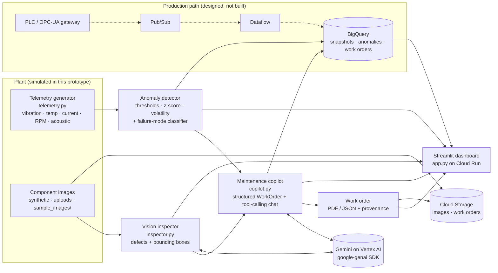

# FactoryPulse architecture

## Data flow

1. **Telemetry** (`telemetry.py`). A synthetic 55 kW pump/motor train emits five channels every 5 s. Fault injection
   (inner-race bearing, thermal overload, cavitation) is applied from a configurable onset with adjustable severity.
2. **Anomaly detection** (`AnomalyDetector`). Each channel is scored against a healthy baseline (first 25 % of the window,
   max 120 samples) using absolute ISO-10816-style limits, persistent z-score excursions, and a short-window volatility ratio.
   A rule-based classifier scores *inner race*, *thermal overload* and *cavitation* from the recent window and a health score
   and `AnomalyReport` (findings, snapshot, hours-to-temperature-limit) is produced.
3. **Visual inspection** (`inspector.py`). The image goes to Gemini with a Level-II NDT prompt and a Pydantic response schema
   (`InspectionReport`). Boxes come back as `[ymin, xmin, ymax, xmax]` on a 0-1000 grid; they are normalised, clamped and
   converted to pixels (`box_to_pixels`) before drawing. Malformed boxes become `None` instead of failing the report.
4. **Copilot** (`copilot.py`). Relevant SOPs and part numbers are retrieved for the suspected failure mode and each defect type
   and injected into the prompt together with the anomaly report and inspection report. Gemini returns a `WorkOrder` via
   structured output. The result is validated (one corrective retry with the validation error), then passed through
   deterministic **safety floors** (telemetry CRITICAL ⇒ at least HIGH; HIGH/CRITICAL ⇒ LOTO required) whose overrides are
   shown in the UI. The chat uses automatic function calling over `lookup_sop`, `lookup_spare_part`, `get_machine_status`.
5. **Resilience and provenance** (`llm.py`). Every Gemini call has a client timeout and up to 2 retries (exponential backoff) on
   429/5xx. Every result carries a `Provenance`: `gemini-live (<model>)`, `fallback (<reason>)` (with the exact exception kept
   for display) or `mock`. A fallback is therefore never silent, and the label is embedded in exported PDF/JSON.
6. **Persistence** (`cloud.py`, optional). With `FACTORYPULSE_GCS_BUCKET`, inspection images and work-order PDF/JSON are saved
   to Cloud Storage. With `FACTORYPULSE_BQ_DATASET`, telemetry snapshots, anomaly flags and work orders are logged to BigQuery
   (load jobs; dataset and tables created on first use) and the Overview's *Fleet analytics* runs three SQL queries. Without
   the flags the same tables and queries run in memory (labelled "local mode"). Cloud failures become UI warnings.
7. **Deployment**. Cloud Run (2 vCPU / 2 GiB, min 1 instance, session affinity) runs the container as a dedicated service
   account with `roles/aiplatform.user`, BigQuery and bucket-scoped Storage roles. On Cloud Run the app resolves to Vertex AI
   automatically (`K_SERVICE` set) so it can never silently default to mock mode.

## Production path (not implemented here)
PLC / OPC-UA gateway → Pub/Sub topic → Dataflow (windowing, feature extraction such as RMS/kurtosis/envelope spectra) →
BigQuery time-series tables; the dashboard would then read from BigQuery instead of the in-process simulator, and the SOP
library would move to Vertex AI Search / RAG over real maintenance documents.
